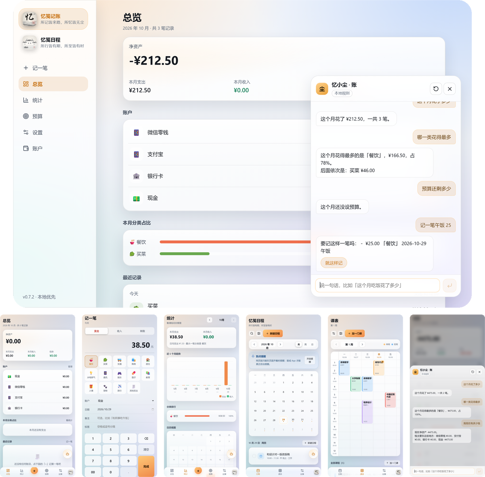

# 忆尘记账 · Yichen Ledger

一个**本地优先**的个人记账应用：一套代码，同时运行在 **Android / iOS / Windows / macOS** 上。
数据全部保存在你自己的设备里（IndexedDB），不经过任何服务器。

> 当前版本 `v0.7.1`：侧边栏重做了一次 —— 「忆尘记账」和「忆尘日程」两块从并排的小图标改成**竖排的图标 + 名称 + 标语**，顶掉了原来那块品牌标题；日程 / 课表 / 设置从胶囊标签挪进了侧边栏菜单，手机端底部导航也跟着多了一项「课表」。



| 忆尘记账 | 忆尘日程 |
| --- | --- |
|  |  |

上面那枚是忆尘日程的图标：白墙黛瓦、一叶小舟、三层烟雨，右下角一枚朱红的「程」印。
两枚并排是一套气质——一枚墨色、一枚朱色，冷暖对照。

---

## 📦 下载安装包

所有平台的现成安装包都在这里，**不需要自己编译**：

**<https://github.com/yichen520-1/yichen-ledger/releases/latest>**

| 平台 | 文件 | 说明 |
| --- | --- | --- |
| Windows | `yichen-ledger-0.7.1-win-x64.exe` | 安装版，可选安装目录 |
| Windows | `yichen-ledger-0.7.1-win-x64.zip` | 免安装，解压即用 |
| macOS（Apple 芯片） | `yichen-ledger-0.7.1-mac-arm64.dmg` | M1/M2/M3/M4 |
| macOS（Intel） | `yichen-ledger-0.7.1-mac-x64.dmg` | 老款 Mac |
| Linux | `yichen-ledger-0.7.1-linux-x86_64.AppImage` | `chmod +x` 后直接运行 |
| Android | `app-debug.apk` | 手机浏览器下载后点安装 |
| iOS | `yichen-ledger-unsigned.ipa` | **未签名**，需自行重签，见下方说明 |

> **安装路径是英文，界面上是中文。** 装好之后程序在
> `%LOCALAPPDATA%\Programs\yichen-ledger\yichen-ledger.exe`，
> .app 叫 `yichen-ledger.app`，Linux 的可执行文件也是 `yichen-ledger` ——
> 全是纯 ASCII，省得非 ASCII 名字在安装脚本、注册表、命令行参数里各走一遍
> 转码；而窗口标题、开始菜单 / 桌面快捷方式、macOS 启动台与 Dock、
> 控制面板里的名字仍然显示「忆尘记账」。详见下方
> [「为什么程序名是英文、界面是中文」](#为什么程序名是英文界面是中文)。

> 没有代码签名证书和 Apple 开发者账号，所以：
> Windows 首次运行会提示「未知发布者」（点「更多信息 → 仍要运行」）；
> macOS 首次打开要在「系统设置 → 隐私与安全性」里点「仍要打开」；
> iOS 的 ipa 是未签名的，用 SideStore / Sideloadly 重签后才能装。

被这些提示卡住、或者只是想先试试，**直接用上面的网页版最省事**。

---

## 🌐 直接用：网页版（最快上手）

**<https://yichen520-1.github.io/yichen-ledger/>**

不用装任何东西，手机和电脑的浏览器打开就能记账。这是一个完整的 PWA：

| 平台 | 怎么装成 App |
| --- | --- |
| iPhone / iPad | Safari 打开 → 分享按钮 → **添加到主屏幕** |
| Android | Chrome 打开 → 右上角菜单 → **安装应用** / 添加到主屏幕 |
| Windows / macOS | Chrome / Edge 地址栏右侧的**安装**图标 |

装到主屏幕后**全屏运行、没有地址栏**，图标就是应用自己的图标，用起来和原生 App 没有区别。
装过一次之后**断网也能用**（Service Worker 缓存了所有静态资源，数据本来就在本机）。

> 网页版和原生包用的是同一份代码、同一个 IndexedDB 库结构，但**数据不互通**
> （不同域名算不同的存储）。长期用建议固定一个平台，或者用「设置 → 导出备份」搬数据。

---

## 技术选型

| 层 | 选型 | 为什么 |
| --- | --- | --- |
| 界面 | React 18 + TypeScript + Vite | 生态成熟、构建快，Web 技术栈能一套代码覆盖四端 |
| 移动端 | Capacitor 7 | 把同一份 web 产物装进原生壳，能上架 App Store / 应用商店 |
| 桌面端 | Electron 33 | Windows/macOS 上开箱即用，不需要用户额外装运行环境 |
| 网页版 | PWA + GitHub Pages | 免安装、免审核，iOS 上没有 Mac 也能先用起来 |
| 数据 | IndexedDB + Dexie 4 | 离线可用、无后端、四端 API 一致 |
| 路由 | HashRouter | Electron 用 `file://`、Capacitor 用 `capacitor://localhost`，只有 hash 路由在四端行为一致 |
| 金额 | **以「分」为单位的整数** | 彻底避免 `0.1 + 0.2 !== 0.3` 这类浮点误差 |

---

## 已经实现的功能

- **记一笔**：支出 / 收入 / 转账三类；自定义键盘输入金额；分类九宫格；备注、标签、日期
- **账户**：现金、电子钱包、银行卡、信用卡、投资五类；设置初始余额；归档 / 删除保护
- **总览**：净资产、本月收支与结余、环比、账户余额、分类占比、按天分组的流水
- **统计**：月度切换、近 6 个月收支趋势柱状图、分类排行、日历热力图、支出最高的几天
- **预算**：按分类或全局设定月度上限；超支标红；支持「仅本月」和「每月重复」
- **分类管理**：内置 21 个中式场景分类，可自定义图标与颜色
- **数据**：JSON 完整备份 / 恢复、CSV 导出（Excel 能直接打开）、CSV 导入（缺的分类账户会自动建）
- **设置中心**（v0.2.0）：通用 / 外观 / 数据 / 关于四组，语言、启动页、字号、配色、圆角一股脑收进来
- **三语**（v0.2.0）：中文 / English / 日本語全量翻译，首次启动跟随系统语言，随时手动覆盖
- **外观自定义**（v0.2.0）：侧边栏、主内容区、底部导航**三块各自独立**的壁纸；每块可调模糊、亮度、
  对比度、饱和度、缩放、偏移、透明度、暗化、适配方式、水平翻转；外加全局字体风格、字号基准、
  文字颜色、强调色、圆角、玻璃面板
- **iOS 手感**（v0.2.0）：页面横向 push/pop、列表交错淡入、按下回弹、弹层阻尼，尊重系统的「减少动态效果」
- **忆尘日程**（v0.3.0）：侧边栏与底部导航的入口，一键在「记账 / 日程」之间换整个工作区（v0.7.0 起改成一枚 App 图标，v0.7.1 起桌面端是竖排的图标 + 名称 + 标语）；月 / 周 / 日三种视图；全天、时间区间、地点、标签、颜色、备注；每天 / 每周 / 每月 / 每年的重复规则（含自定义间隔与重复日）；勾选完成、搜索、删除
- **从图片建日程**（v0.3.0）：拍一张课程表或会议通知，填了 API Key 走云端多模态，没填就走本机 OCR（tesseract.js，第一次用要下语言包）
- **到点提醒**（v0.3.0）：Android / iOS 走系统本地通知，App 关着也能弹；网页版退化成页面内提醒，并明确告知这个限制
- **忆小尘 · 账**（v0.4.0）：总览 / 统计页右下角的助手按钮。问「这个月花了多少」「哪一类最多」「预算还剩多少」「我现在有多少钱」「哪一类涨得最快」，也能直接说「记一笔午饭 25」——它把账目摆出来给你确认，点「就这样记」才真的落库
- **忆小尘 · 程**（v0.4.0）：日程页右下角的同一个助手，换个身份管时间。问「这周有几个日程」「周五下午有空吗」「接下来是什么」，或者说「提醒我周三下午三点交报告」，同样要你点确认才建日程
- **两种脑子的混合式**（v0.4.0）：不填 API Key 时全部走本机规则引擎（纯函数，不联网、不出设备）；在设置里填了 Key，同一个对话框自动改走云端大模型，答不上来会**退回本地算的结果**而不是给你一句错误
- **真的能聊天**（v0.5.0）：问候、自我介绍、道谢、报时、报日期、四则运算、讲个笑话，以及**按情绪分类的回应**——说累、说难过、说生气、说焦虑、说开心、说无聊、说孤单，各有一句，不是一句「听起来不太好」糊弄所有人。这一层只在规则引擎没接住时才会跑，「这个月花了多少」「记一笔午饭 25」永远不会被它抢走
- **水晶玻璃界面**（v0.6.0）：所有面板级元素（卡片、弹层、侧边栏、底部导航、对话框）统一成 iOS 26 那种液态玻璃——半透 + 模糊 + 提饱和、顶部一道内高光、一圈极细亮边、一层柔和投影；底层铺一层固定的水墨光斑，玻璃才「有东西可透」
- **浅色主题**（v0.6.0）：跟随系统 / 深色 / 浅色三选一。不是把深色反过来——浅色下靠暗色描边和投影把面板托起来，透明度公式和深色方向相反
- **玻璃强度**（v0.6.0）：一个 0~150 的滑块（0 = 实心省电，100 = 出厂，150 = 最通透），模糊和饱和度跟着一起走；老设置会自动迁移
- **侧边栏重做**（v0.7.1）：「忆尘记账 / 忆尘日程」两块改成**竖排的图标 + 名称 + 标语**，顶掉了原来那块品牌标题；没选中的那个压暗但照样能点
- **日程 / 课表变成菜单项**（v0.7.1）：原来挂在日程页右上角的两个胶囊标签删掉了，改成侧边栏里的独立菜单项，地址也从小尾巴变成真路由 `#/schedule/timetable`（老链接会自动跳过去）
- **手机底部导航加「课表」**（v0.7.1）：日程模式下是「日程 / 课表 / 设置」三项，再留一枚切 App 的图标；课表不是日程的子标签，而是并列的第二项
- **两个 App，两枚图标**（v0.7.0）：原来那个「切换功能」的胶囊删掉了，改成两枚真图标——桌面端在侧边栏（v0.7.1 起竖排并带上名称与标语），手机端在底部导航只露另一个 App 的图标。忆尘日程有了自己的江南风图标（白墙黛瓦、一叶小舟、烟雨里一枚朱红的「程」印），和忆尘记账的水墨图标是一套气质
- **忆小尘可拖**（v0.7.0）：右下角那颗按钮按住就能拖，松手自动吸到最近的左右边缘，位置按比例存进库里——换屏幕尺寸、转屏都还在原来的相对高度
- **课表**（v0.7.0）：忆尘日程里多一个「课表」（v0.7.1 起从页内标签变成侧边栏的独立菜单项）。七列星期 × 节次的网格，支持单双周、周次范围、开学日期与总周数、可自定义的节次时间表；今日剩余课程、冲突提示、单双周图例都在一屏里
- **从图片建课表**（v0.7.0）：拍一张或贴一张课程表，填了 API Key 走云端多模态（要求返回 JSON，因为一门课有多个时段），没填就走本机规则解析；解析出来的候选逐条勾选再导入，重名课程可以选择覆盖
- **离线 & 隐私**：无网络依赖、无账号、无埋点

---

## 还能往哪些方向做（功能路线图）

如果你想让记账 App 更有「记忆点」，下面这几条是最值得做的方向，按投入产出排序。

### 如果只做三件事

功能清单可以列一百条，但真正决定这个 App 有没有人天天用的，其实只有三件：

| 要做的 | 为什么是它 | 大概工作量 |
| --- | --- | --- |
| **记账快到不用思考**（快捷模板 + 上次金额带出） | 记账 App 九成死因是「懒得记」，不是功能不够 | 2~3 天 |
| **周期性账单自动生成** | 房租/话费/会员这类占了支出大头，自动生成能直接免掉一半的动手 | 3~5 天 |
| **月度报告（生成一张可分享的图）** | 是唯一能让人主动截图发朋友圈、帮你带来新用户的功能 | 2~3 天 |

以下是可以排在其后的完整清单。

### 1. 降低「记账摩擦」——这是记账 App 的生死线
记账失败的原因九成是「懒得记」。所以优先级最高的是让记录快到不可思议：
- [ ] **快捷模板 / 常用组合**：「早餐 12 元」一键记账，点一下完成
- [ ] **上次同分类自动带出金额与账户**（连按三次「餐饮」就自动建议 25 元）
- [ ] **桌面小组件 / 锁屏组件**（iOS Widget、Android 桌面小部件）
- [ ] **全局快捷入口**：手机下拉通知栏、电脑常驻托盘 + 全局快捷键
- [ ] **自然语言记账**：「午饭 25 支付宝」直接解析成一条记录

### 2. 让数据「说话」——从记录变成洞察
- [ ] **周期性账单**：房租、会员、话费自动生成，到期前提醒
- [ ] **月度报告**：月底生成一张可分享的「本月消费画像」图片
- [ ] **同比 / 环比对比**：和去年同期比，找出「不知不觉变贵」的项目
- [ ] **储蓄率与财务健康度**：结余率、应急金月数、负债率
- [ ] **异常支出提醒**：某分类突然暴涨时给出提示

### 3. 账户与资产视角
- [ ] **多币种**：旅行记账、汇率折算
- [ ] **信用卡账单周期**：账单日 / 还款日，免息期计算
- [ ] **投资账户**：持仓市值、收益率（这一块复杂度高，建议后置）
- [ ] **债务管理**：借入借出、人情往来记录

### 4. 协作与同步
- [ ] **多人共享账本**：家庭账本、AA 分账
- [ ] **端到端加密同步**：可选自建 WebDAV / 坚果云，或自建后端
- [ ] **数据导出为通用格式**：便于从其他记账软件迁移进来

### 5. 平台特性
- [ ] **生物识别锁**：Face ID / 指纹 / Windows Hello
- [x] **多语言**：中文 / 英文 / 日文（v0.2.0 已做）
- [x] **日程 / 日历模块**：月 / 周 / 日视图、重复规则、图片识别（v0.3.0 已做）
- [x] **AI 助手**：自然语言问答 + 语音式记账（v0.4.0 已做，本地规则 + 可选云端）
- [ ] **语音输入**：手机上直接说一句话记账（现在要打字，Web Speech API 可以接）
- [ ] **日程与账单打通**：把「还信用卡」这类日程一键生成周期账单
- [x] **浅色主题**：跟随系统 / 深色 / 浅色三选一（v0.6.0 已做）
- [ ] **桌面端系统托盘常驻 + 开机自启**

---

## 本地运行

```bash
# 安装依赖
npm install
# 浏览器里开发（http://localhost:5173）
npm run dev

# 单元测试（109 个用例，只测纯领域层，不需要浏览器）
npm test

# 构建 web 产物到 dist/
npm run build

# 桌面端：先启动 dev server，再开 Electron
npm run dev:desktop

# 直接跑打包后的桌面版（需要先 npm run build）
npm run electron
```

### 自检脚本

仓库里带了十个用来确认「真的能跑」的脚本，CI 或本地改完代码都可以跑（另有两个只出图不断言的截图脚本，见下）：

```bash
npm run build
npx vite preview --port 4173 &      # 先起一个静态服务
node scripts/smoke.mjs              # 用真实 Chrome 走一遍记账流程并截图到 .shots/
node scripts/flows.mjs              # 深流程：预算超支、建账户、改账目、建分类、持久化
node scripts/pwa-check.mjs          # 网页版：manifest、图标、SW 缓存、断网后还能打开
node scripts/live-check.mjs         # 直接打线上 Pages 地址，端到端验证线上那份能用
node scripts/appearance-check.mjs   # 设置页四组、切语言、上传壁纸、分区独立生效
node scripts/schedule-check.mjs     # 忆尘日程 + 课表：双 App 入口、月/周/日视图、课表网格、增删改、持久化
node scripts/assistant-check.mjs    # 忆小尘：入口位置、问账、记一笔要确认、切模式不丢对话
node scripts/chat-check.mjs         # 忆小尘闲聊：问候、情绪、算术、报时，且不抢走记账
node scripts/cloud-chat-check.mjs   # 云端链路：假 OpenAI 服务，验请求内容、历史、兜底
node scripts/installed-check.mjs    # 本机装的桌面版是不是当前这份（发版后必跑）

# 或者验证桌面端（Electron 直接加载 dist/index.html）
node_modules/electron/dist/electron.exe --no-sandbox --user-data-dir=.shots/edata scripts/electron-check.cjs
```

`scripts/smoke.mjs` 会：打开首页 → 输入金额 → 选分类 → 保存 → 回首页确认 → 遍历统计/预算/我的/账户/分类 → 桌面宽度再截一轮，任何控制台报错都会让脚本以非 0 退出。

`scripts/flows.mjs` 会：新建总预算 → 记一笔 1500 元把钱花超 → 断言进度条变红 → 新建账户 → 点首页的账目进编辑页改金额 → 新建分类 → 刷新页面确认 IndexedDB 里数据还在 → 确认主题变量落在两套调色板之一、玻璃变量算出了具体值（v0.6.0 起有两套主题，原来硬断言深色会假失败）。

`scripts/pwa-check.mjs` 会：断言 manifest 能被解析且 display 是 standalone → 四个图标都能下载 → Service Worker 进入 `activated` → 缓存里真的有 index.html 和带 hash 的 JS → **切到离线模式后刷新，页面照样能打开**。最后一项是网页版能不能「装到主屏当 App 用」的关键。

`scripts/live-check.mjs` 不走本地，直接打开 <https://yichen520-1.github.io/yichen-ledger/>：记一笔 66.66 元、断言净资产跟着变、四个子页面都能渲染、SW 已注册、没有控制台错误。用来确认**部署上去的那一份**（而不是本地 dist）真的可用。发布之后跑一次最踏实。

`scripts/schedule-check.mjs` 的课表部分会：断言网格格子数正好是「节次 × 7」、七个星期表头齐全、窄屏下卡片不横向溢出（`overflow` 生效且可以横滚）、第几周显示正确、加一门课之后刷新页面课程还在。

另外三个**只出图不断言**的脚本：`node scripts/assistant-shot.mjs` 出忆小尘的对话面板，`node scripts/timetable-shot.mjs` 出课表在手机与桌面两种宽度下的样子（含课表设置面板和加课面板），`node scripts/sidebar-shot.mjs` 出侧边栏改版后的样子（桌面两块竖排、手机底部导航、课表页），都存到 `.shots/`。`scripts/make-screenshots.py` 再把 `.shots/` 里的图拼成 `docs/screenshots/preview.png`。

`scripts/appearance-check.mjs` 专门盯 v0.2.0 的新东西：设置页四组齐全 → 本地存储横幅在 → 语言下拉切到英文后导航文字和
`<html lang>` 一起变 → 字号基准调到 120% 后实际字号变大 → 用 canvas 现场生成一张图当壁纸上传 →
**只有主内容区出现壁纸、侧边栏仍为空**（验证三区域独立）→ 回总览后壁纸还在。

`scripts/schedule-check.mjs` 盯 v0.3.0 起的日程与 v0.7.0 起的课表（v0.7.1 起跟着侧边栏改版重写）：
侧边栏两块是上下排的、等宽且撑满、各自带图标与标语、顶部没有单独的 brand 块 →
日程模式下侧边栏是「日程 / 课表 / 设置」三项、手机底部导航也是这三项 → 点「课表」进的是 `#/schedule/timetable` →
月视图 42 格、周标题从周一开始 →
新建一条日程后列表里出现且时间正确 → 勾选后标记完成 → 周视图 7 列、日视图有日期标题 → 搜索能命中 →
课表网格格子数正好是「节次 × 7」、窄屏可横滚 → 加一门课后课块出现在正确的星期列、跨正确的行数 →
刷新后仍停在课表路由（标题「课表」、底部导航高亮在课表）、课程还在 → 切回记账模式回到总览。

`scripts/assistant-check.mjs` 盯 v0.4.0：助手按钮只在总览 / 统计 / 日程三个页面出现（记账页不显示，免得挡住数字键盘）→
没填 Key 时徽标写「本地规则」→ 记两笔后问「这个月花了多少」「哪一类花得最多」「我现在有多少钱」都答得上 →
说「记一笔午饭 25」只给出确认按钮，**点之前直接查 IndexedDB 确认没写库，点了之后 count 才 +1** →
切到日程模式后标题变成「忆小尘 · 程」、对话不丢、日程示例换成日程相关 → 全程零控制台错误。

`scripts/chat-check.mjs` 盯 v0.5.0 的闲聊层（22 项）：打招呼 / 问身份 / 问能力 / 道谢 / 算术 / 报时 / 报日期 /
说累 / 说难过 / 「嗯」/「随便聊聊」各问一遍，然后立刻验证**账本功能一个没坏**——
查总额、查分类、追问「那上个月呢」、记账确认，以及 `好，记一笔午饭 25` 这种带应答词的写操作
必须照常走记账流程而不是被闲聊吃掉。

`scripts/cloud-chat-check.mjs` 盯云端链路（15 项）：起一个假的 OpenAI 兼容服务，
真的把 Key 填进设置 → 断言徽标变「云端」→ 闲聊与开放问题确实发了 POST →
**请求体里带着账本摘要和前三轮对话** → 数据类问题仍然本地算、不发请求 →
云端返回 500 时显示「云端没答上来（原因）」并保住本地答案 → 云端挂了打招呼仍有人接。

`scripts/installed-check.mjs` 盯一个很蠢但很容易犯的错：**发完版忘了重装本机那份**。
它会打开 `%LOCALAPPDATA%\Programs\yichen-ledger\resources\app.asar`，
读出里面 `dist/index.html` 引用的 bundle 名，和当前 `dist/` 比对。
不一致就说明你看到的是旧界面 —— v0.5.0 发完后就踩过这个坑：
代码、网页版、Release 全对，只有本机那份还是 v0.4.0，看起来像「修了个寂寞」。
加 `--strict` 时不一致会以非 0 退出。

### 推送代码时如果连不上 GitHub

这台机器到 GitHub 的 HTTPS 经常连不上，分两种表现：

| 表现 | 说明 |
| --- | --- |
| `Failed to connect to github.com:443` / `Connection was reset` | DNS 解析到的 IP 该端口不通 |
| `OpenSSL SSL_read: unexpected eof while reading` | TCP 和 TLS 都握手成功了，但 HTTP 请求发出去就没回音 |

第二种最迷惑人：`Test-NetConnection github.com -Port 443` 明明返回 `True`，
`git push` 却一直超时。原因是端口能建立连接不代表整条链路通。**这时换 SSH 最省事**：

```bash
# 一次性：生成密钥并把公钥加到仓库的 Deploy keys（勾选 Allow write access）
ssh-keygen -t ed25519 -f ~/.ssh/yichen_ledger -N "" -C "yichen-ledger deploy"
# 然后把 ~/.ssh/yichen_ledger.pub 的内容贴到
#   https://github.com/yichen520-1/yichen-ledger/settings/keys

# 让这个仓库走 SSH（只写进 .git/config，不会提交）
git remote set-url origin git@github.com:yichen520-1/yichen-ledger.git
git config --local core.sshCommand 'ssh -i ~/.ssh/yichen_ledger -o BatchMode=yes'
```

实测 `github.com:22` 与 `ssh.github.com:443` 都通，SSH 比 HTTPS 稳得多。

另一条路是走本地 CONNECT 代理（仓库外 `.tmp-ssh/proxy.mjs`，已被 gitignore），
把连接强制转到可用 IP：

```bash
node .tmp-ssh/proxy.mjs                                  # 另开一个终端
git -c http.proxy=http://127.0.0.1:7899 push origin main
```

还有一点：这台机器上 `git` 的 `http.sslBackend` 是 `schannel` 时会报
`schannel: AcquireCredentialsHandle failed: SEC_E_NO_CREDENTIALS`，
需要 `git -c http.sslBackend=openssl`（或 `git config --global http.sslBackend openssl` 永久改掉）。

## 打包到各平台

### Windows / macOS（Electron）

已经接好 `electron-builder`，配置在 [electron-builder.config.cjs](electron-builder.config.cjs)：

```bash
npm run pack:win     # Windows：NSIS 安装包 + 免安装 zip
npm run pack:mac     # macOS：dmg（需在 macOS 上执行）
npm run pack:dir     # 只解包不打包，用来快速验证
```

图标是水墨风，画法写在 [`scripts/make_icon_common.py`](scripts/make_icon_common.py) 的
`draw_icon()` 里，四端和网页共用同一份：米白宣纸底 + 三层远山（越近越浓）+
山腰云气 + 右上角飞雁，焦墨行书「忆」压在正中，右下角盖一枚朱红「记」印。

```bash
npm run make:icon                       # Windows / macOS 图标 + Android + iOS
python scripts/make-pwa-assets.py       # 网页版用的那几张 PNG
```

> 两个细节是踩过坑才定下来的：山不能只有墨色渐变，`_mountain_layer()` 里
> 必须再加一道山脊的浓墨线和一层「斧劈皴」的块面，否则远看只是一团灰雾；
> 飞鸟的 `span` 是**整只鸟的翼展**，不是半翼展 —— 按半翼展算出来的鸟只有
> 20 来像素，看整张图根本找不到。

字体放在 [`assets/fonts/`](assets/fonts/)，都是 SIL OFL 1.1 授权（志莽行书用于
「忆」，马善政毛笔楷书备用），只用来生成图标，不进安装包。印章上的「记」用
宋体加粗后做刀刻处理 —— 本机没有篆书字体，篆书虽是印章正体，但装不上就算了。

产物结构：`yichen-ledger-0.7.1-win-x64.exe`（约 88 MB，可选安装目录）、
`yichen-ledger-0.7.1-win-x64.zip`（免安装，约 112 MB）。

> **排坑：别在项目目录里跑产出的安装包。** NSIS 生成卸载程序时会执行一次
> 自己产出的安装包。如果安装包就躺在项目目录里（比如
> `D:\Desktop\忆尘记账\release\`），这一步会退出码 2、弹
> `Failed to uninstall old application files`、一个文件都不装。配置里因此把
> 产物输出到系统临时目录（`%TEMP%\yichen-ledger-release`），代码见配置里的
> `resolveOutput()`。
>
> 这条最初被记成「中文路径」的锅，后来做了对照实验才知道不准确：同样的中文
> 路径放到项目目录之外（`D:\Desktop\忆尘记账安装测试\忆尘记账 Setup.exe`）
> 安装一切正常，而项目目录内的纯 ASCII 子目录照样失败。差别在那个目录本身的
> 环境，不在名字。把链路改成 ASCII 仍然值得保留 —— 它是稳妥的默认姿势 ——
> 但它不是那次报错的根因。

> **排坑：界面上的版本号是手写的。** 界面底部和「我的 → 关于」原来写死了
> `v0.1.0`，发 0.1.1 时忘了改，装好的新版本还显示旧版本号。现在
> [`vite.config.ts`](vite.config.ts) 在构建时读 `package.json` 的 `version`
> 注入成 `__APP_VERSION__`，界面里直接用这个常量，版本号只维护一处。

### 为什么程序名是英文、界面是中文

一句话：**`productName` 管显示，`executableName` 管文件**，两者在
[electron-builder.config.cjs](electron-builder.config.cjs) 里分开设置。

```js
productName: '忆尘记账',        // 窗口标题、快捷方式、启动台、控制面板
executableName: 'yichen-ledger', // 程序目录名、可执行文件名 —— 必须是纯 ASCII
```

分开的理由不是洁癖，是踩出来的：一开始把 `productName` 当文件名用，安装目录
是 `%LOCALAPPDATA%\Programs\忆尘记账`，程序叫 `忆尘记账.exe`，卸载器叫
`Uninstall 忆尘记账.exe`。这些名字要经过 NSIS 脚本、注册表、快捷方式、
命令行参数好几道手，任何一道对非 ASCII 处理不当都会炸，而且排查起来很难。
把「用户看到什么」和「文件叫什么」拆开之后，这条链路上再没有编码可言。

（补充一句实证过的结论：**中文路径本身不会导致安装失败**。同一台机器上，
把安装包放在 `D:\Desktop\忆尘记账安装测试\忆尘记账 Setup 0.1.1.exe` 里双击，
装到 `%LOCALAPPDATA%\Programs\yichen-ledger` 一切正常；目标目录特意指定成
`%LOCALAPPDATA%\Programs\忆尘记账中文测试` 也能装。所以拆开名字是为了减少
变量、而不是在修一个「中文路径装不上」的 bug。真正会炸的是另一件事：**别在
项目目录里跑产出的安装包**，见上文那条排坑。）

各平台落地情况：

| 平台 | 磁盘上的名字 | 用户看到的名字 |
| --- | --- | --- |
| Windows | `%LOCALAPPDATA%\Programs\yichen-ledger\yichen-ledger.exe` | 开始菜单 / 桌面快捷方式「忆尘记账」，窗口标题「忆尘记账」，控制面板「忆尘记账 0.7.1」 |
| macOS | `/Applications/yichen-ledger.app` | Finder、启动台、Dock 显示「忆尘记账」（来自 `CFBundleName` / `CFBundleDisplayName`） |
| Linux | `yichen-ledger` 可执行文件 + `*.AppImage` | 应用菜单里显示「忆尘记账」（`.desktop` 的 `Name`） |
| Android / iOS | `com.yichen.ledger` | 桌面图标下的名字「忆尘记账」 |

> **换名字不会丢数据。** Electron 的用户数据目录取的是 `package.json` 的
> `name`，本来就是 `yichen-ledger`（Windows 上是
> `%APPDATA%\yichen-ledger`）。所以把可执行文件从 `忆尘记账.exe` 改成
> `yichen-ledger.exe`，账本、设置、IndexedDB 全都原地不动。

**这条约定不是靠人记住，是 CI 每次打包都验的。** 五个平台的任务在打包之后各加了一步
「核对」，跑不过就让流水线红掉：

| 平台 | CI 里核对什么 |
| --- | --- |
| Windows | `release\win-unpacked\yichen-ledger.exe` 存在，且 `FileDescription` 是「忆尘记账」 |
| macOS | `release/mac-arm64/yichen-ledger.app` 与 `release/mac/yichen-ledger.app` 都存在，`CFBundleName` / `CFBundleDisplayName` 是「忆尘记账」 |
| Linux | 解出 AppImage，`.desktop` 的 `Name=` 是「忆尘记账」，同目录下的可执行文件是 ASCII |
| Android | `aapt dump badging` 的 `versionName` 等于 `package.json` 的版本，`application-label` 是「忆尘记账」 |
| iOS | `App.app` 目录名是 ASCII，`CFBundleDisplayName` 是「忆尘记账」 |

所以以后谁改配置改坏了，或者发版忘了升版本号，CI 会直接拦住。

> 没有代码签名证书，所以安装时 Windows SmartScreen 会提示「未知发布者」，
> 点「更多信息 → 仍要运行」即可。要消掉这个提示需要购买代码签名证书。

### 安装器为什么要自定义 NSIS 脚本（`build/installer.nsh`）

electron-builder 生成的安装器在装新版本前，会先去执行旧版本的卸载器。
它从注册表读 `UninstallString` 和 `InstallLocation`，把旧卸载器复制到
`$PLUGINSDIR` 里再 `ExecWait` 等它结束。如果旧安装目录被手工删掉/移动过
（或者注册表里是一条残留项），这一步必然失败，而模板里的默认处理是：

```
MessageBox "Failed to uninstall old application files. Please try running the installer again.: 2"
SetErrorLevel 2
Quit
```

也就是说，**用户从此再也装不上任何新版本**，除非自己去清注册表。这是个
很糟糕的失败模式，而本应用是装在 `%LOCALAPPDATA%\Programs` 下的按用户安装，
用户手滑删目录太常见了。

所以 [`build/installer.nsh`](build/installer.nsh) 覆盖了
`customUnInstallCheck` / `customUnInstallCheckCurrentUser` 两个钩子：
旧卸载器返回非 0 时只写进安装日志，然后继续装新版本——新版本会重写
注册表项和快捷方式。最坏的情况是留下一个孤立目录，用户自己删掉即可。

验证方式（模拟用户遇到的脏状态）：手工在
`HKCU\Software\Microsoft\Windows\CurrentVersion\Uninstall\<APP_GUID>`
下写一条指向不存在目录的 `UninstallString`，再静默运行安装包 ——
修复前退出码 2 并弹窗，修复后退出码 0、正常装上。

### Android（Capacitor）

Android 工程已经在 `android/` 目录里生成好并提交进仓库了，
换一台机器只要重装依赖就能接着用。构建需要 Android Studio（或 SDK + JDK 17+）：

```bash
npm run build
npm run cap:sync          # 把 dist/ 同步进 android/
npx cap open android      # 在 Android Studio 里运行 / 打 APK
```

如果 `android/` 目录被删了，用 `npx cap add android` 重新生成，
注意重新生成后再手动改一次 `android/app/src/main/res/values/strings.xml`
里的 `app_name`（生成器默认会写成英文名）。

> 仓库里没有 APK 产物（3.9 MB 的 debug 包不进版本库），
> 用 Android Studio 打开 `android/` 目录，等 Gradle 同步完就能直接跑真机或模拟器。

> **排坑：项目路径含中文。** AGP 遇到非 ASCII 路径会直接拒绝构建，报
> `Your project path contains non-ASCII characters`。仓库里已经在
> `android/gradle.properties` 打开 `android.overridePathCheck=true`，
> 实测能正常编译出 APK。另外 `android/build.gradle` 里加了阿里云 Maven
> 镜像放在 `google()` / `mavenCentral()` 前面 —— 国内直连 Maven Central
> 经常超时，会报 `Could not resolve org.jetbrains.kotlin:kotlin-stdlib-jdk8`。

### iOS（Capacitor）

`ios/` 工程骨架也已经生成好并提交了。构建必须在 macOS 上、装好 Xcode：

```bash
npm run build
npm run cap:sync
npx cap open ios         # 在 Xcode 里运行 / 打包
```

> Windows 上没法编译 iOS，但 Capacitor 是跨平台的，在 Windows 上照样能
> 生成 `ios/` 工程（只是会跳过 `pod install`）。到 Mac 上先跑一次
> `npx cap sync ios` 装好 Pod 依赖，再用 Xcode 打开。
>
> 上架 App Store 还需要 Apple 开发者账号（$99/年）配置签名，
> 只想自己用的话用免费个人账号装到自己的设备上就行（7 天要重签一次）。

### 让 CI 帮你出全平台安装包

在一台 Windows 机器上做不出 macOS 的 dmg，也编译不了 iOS 的 ipa。
[.github/workflows/build-installers.yml](.github/workflows/build-installers.yml)
把这一步交给 GitHub Actions —— 它三种系统的 runner 都有：

```bash
git tag v0.7.1
git push origin v0.7.1
```

推一个 `v*` 的 tag 就会并行跑五个任务，然后建一个 Release，把产物挂上去：

| 任务 | 运行环境 | 产物 |
| --- | --- | --- |
| windows | `windows-latest` | NSIS 安装包 + 免安装 zip |
| macos | `macos-latest` | dmg（arm64 + x64） |
| linux | `ubuntu-latest` | AppImage |
| android | `ubuntu-latest` + JDK 21 | `app-debug.apk` |
| ios | `macos-latest` + CocoaPods | 未签名 ipa |

也可以去 Actions 页面手动 `Run workflow`，那样只留 artifact 不建 Release。

### 发版说明写在仓库里

Release 页面上那一大段中文说明不在 workflow 里，而是在
[`docs/releases/`](docs/releases/) 目录下，文件名就是 tag 名：

```bash
# 例：写 v0.2.0 的说明
docs/releases/v0.2.0.md
```

打 tag 之前先把说明写好提交，`release` 任务会去找
`docs/releases/<tag>.md` 并作为 Release 正文；找不到就退回一段通用说明
（不会因为少写文档而让发布失败）。这样做的好处是：说明可以单独 review、
可以改、可以留着给下个版本抄结构，不用在一堆 YAML 里写长文。

> **产物文件名是纯 ASCII。** GitHub 会把 Release 资产名里的非 ASCII 字符
> 统统替换成 `.`（`忆尘记账 Setup 0.1.0.exe` 会变成 `Setup.0.1.0.exe`），
> 所以 `electron-builder.config.cjs` 里给三端都设了 `artifactName`，
> 统一成 `yichen-ledger-<版本>-<平台>-<架构>.<扩展名>`。
> 装好之后显示的名字、快捷方式、窗口标题仍然是「忆尘记账」，不受影响。


> **iOS 的包是未签名的。** 没有 Apple 开发者证书，`xcodebuild` 只能出
> `CODE_SIGNING_ALLOWED=NO` 的产物，iPhone 上直接装不了。拿到后用
> SideStore / Sideloadly 这类工具在本地重签，或者干脆把 `ios/App` 拖进
> Xcode 用你自己的免费账号跑一次真机。
>
> Android 用的是模板自带的 debug keystore，自用没问题，上架要换正式签名。

---

## 网页版部署（GitHub Pages）

推送到 `main` 之后 GitHub Actions 会自动构建并发布，配置在
[.github/workflows/deploy-pages.yml](.github/workflows/deploy-pages.yml)：

**<https://yichen520-1.github.io/yichen-ledger/>**

流程是：`npm ci` → `npm test` → `npm run build` → 上传 `dist/` 到 Pages。
想手动重新发布就在 Actions 页面点一次 `Run workflow`。

因为 `vite.config.ts` 里 `base` 用的是相对路径 `'./'`，产物既能放在
`https://yichen520-1.github.io/yichen-ledger/` 这样的子路径下，也能
直接被 Electron 用 `file://` 打开，一份产物四种用法。

> PWA 的离线能力由 [public/sw.js](public/sw.js) 提供。它在 `install` 阶段
> 会去解析 `index.html`，把里面带 hash 的 `assets/*.js`、`*.css` 一起预缓存 ——
> 这一步不能省：Service Worker 是页面加载完才注册的，第一次加载的 JS
> 根本不经过它，不预缓存的话「装完马上断网」会白屏。
>
> 换了资源就要让用户拿到新版本，所以缓存名 `CACHE = 'yichen-ledger-v8'`
> 改动后要顺手升个号。Electron（`file://`）和 Capacitor（`https://localhost`）
> 里会跳过注册，靠 `window.Capacitor` 判断，避免壳里读到旧缓存。

---

## 目录结构

```
src/
  domain/model.ts        纯领域逻辑：金额、日期、汇总、CSV（无框架依赖，可单测）
  domain/schedule.ts     日程的纯逻辑：重复规则展开、跨天/全天、提醒时间、视图分栏
  domain/ocr.ts          把识别出来的文字猜成日程（纯函数，可单测）
  domain/assistant.ts    忆小尘的本地规则引擎：问账、记一笔、问日程、找空档（纯函数，可单测）
  domain/timetable.ts    课表的纯逻辑：周次换算、单双周、一周课块、冲突检测、今日剩余（纯函数，可单测）
  domain/timetableOcr.ts 把识别出来的文字猜成课表条目（纯函数，可单测）
  db/index.ts            Dexie 表结构与默认账户/分类
  db/repository.ts       所有增删改查、导入导出（错误只抛错误码，翻译留在界面层）
  i18n/                  中 / 英 / 日三份词典 + useI18n / useErrorText
  state/LedgerContext.tsx 用 useLiveQuery 订阅数据库，写库后全站自动刷新
  state/AppearanceContext.tsx 三区域壁纸、字体、配色，写 CSS 变量并落到 settings 表
  state/ModeContext.tsx  记账 / 日程两个工作区的切换状态
  state/assistant.tsx    忆小尘的对话状态：本地先算、有 Key 再问云端、失败退回本地
  state/AssistantContext.tsx 把对话提到全局，切页面/切模式不丢
  state/notify.ts        到点提醒：原生本地通知 / 网页版降级
  state/ai.ts            云端 AI 配置（Base URL、模型、Key），没配就走本地
  pages/                 总览 / 记一笔 / 统计 / 预算 / 我的 / 账户 / 分类
  pages/Schedule.tsx     忆尘日程主页面（月 / 周 / 日三视图）
  pages/schedule/        日程与课表：ScheduleShell（日程/课表两个标签）、TimetablePage、弹层组件（表单、搜索、图片识别）
  components/AssistantPanel.tsx 忆小尘的对话框（portal 到 body）
  components/AssistantFab.tsx   忆小尘的入口悬浮球（可拖动、吸边、位置存库）
  components/AppRail.tsx 两个 App 的图标入口（桌面端并排 / 手机端只露另一个）
  components/AssistantHost.tsx  对话框的开关状态，供 App 与页面共用
  components/Toast.tsx   轻提示
  components/Sheet.tsx   底部弹层（portal 到 body，避免被 transform 祖先困住）
  components/Backdrop.tsx 单个区域的背景图层
  styles.css             深色主题，移动优先，>=900px 切桌面布局
public/
  manifest.webmanifest   PWA 清单（名字、图标、快捷方式）
  sw.js                  Service Worker：离线缓存
  pwa-*.png              网页版图标（忆尘记账）
  schedule-*.png         忆尘日程的图标（由 scripts/make-schedule-icon.py 生成）
tests/domain.test.ts     记账领域层单元测试
tests/schedule.test.ts   日程领域层单元测试（重复规则、视图分栏、OCR 猜时间）
tests/timetable.test.ts  课表领域层单元测试（周次、单双周、课块、冲突、OCR 猜节次）
tests/assistant.test.ts  忆小尘规则引擎单元测试（时间区间、分类匹配、记账解析、找空档）
electron/main.cjs        桌面端主进程
capacitor.config.ts      移动端配置
build/                   electron-builder 用的图标（由 scripts/make-icon.py 生成）
docs/screenshots/        README 里的界面预览图（由 scripts/make-screenshots.py 生成）
.github/workflows/       GitHub Pages 自动部署 + 全平台安装包构建
scripts/                 自检脚本 + 图标生成
android/  ios/           Capacitor 生成的原生工程
```

---

## 数据说明

- 所有金额在内存和数据库里都是「分」的整数，展示时才换算成元
- 账户余额 = 初始余额 + 收入 − 支出 ± 转账
- 净资产只统计「计入总资产且未归档」的账户
- 转账不计入收支统计，只在账户之间移动
- 备份是普通 JSON 文件，你可以直接打开查看，数据不被锁定

## 许可证

MIT
